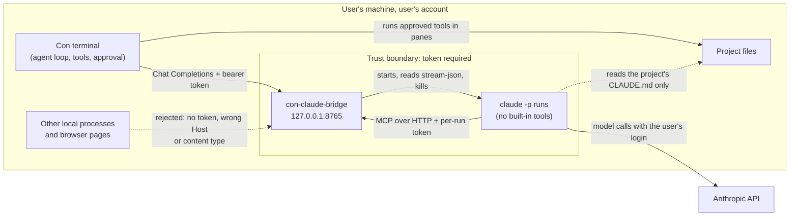
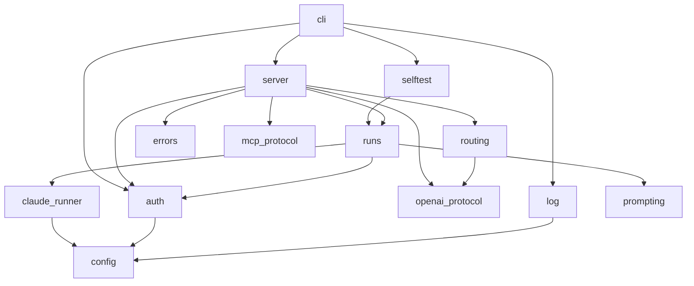

# con-claude-bridge architecture

**Status:** Accepted, 2026-10-16. Completed for issue #5 with goals, module
ownership, threads, start-up, deployment, failure modes, observability and
testing. This document and the decision records (ADRs) in
[`docs/adr/`](adr/) are the source of truth, and a change of direction needs a
new or updated ADR.

Read this before changing the bridge's protocol, run handling, process model or
deployment. It explains how the bridge routes the Con terminal's AI panel
through Claude Code while Con's harness stays in charge. Two companion pages
cover the rest: [`configuration.md`](configuration.md) lists every setting and
file path, and [`implementation-plan.md`](implementation-plan.md) gives the
order in which the bridge gets built. The [glossary](#glossary) at the end
defines turn, step, run and the other terms used here.

## What the bridge does

con-claude-bridge is a small HTTP server on `127.0.0.1`. Con's built-in agent
sees it as an "OpenAI-compatible" model provider. Behind it, Claude Code does
the thinking, run as `claude -p` with the login already on the machine.

Everything else stays with Con. Claude Code gets Con's tools and none of its
own. When Claude wants to run a command or edit a file, the request appears in
Con as a normal tool call. Con asks for approval, runs it in a pane and shows
the result, as it would for any provider. The bridge hands Con's tools to
Claude Code as a Model Context Protocol (MCP) server, which is the standard way
Claude Code takes tools from outside. See
[ADR-0002](adr/0002-claude-code-as-a-step-in-cons-agent-loop.md).

## Goals and non-goals

The bridge succeeds when all of these hold:

- Every action Claude takes is a Con tool call, shown in Con's tool card and
  run only after Con's approval prompt, exactly as with any other provider.
- Nothing outside the user's own Con can drive it: no other local process, no
  web page and no other machine
  ([ADR-0006](adr/0006-localhost-service-with-token.md)).
- It installs with `pacman` and needs nothing at run time beyond Python and
  `claude` ([ADR-0004](adr/0004-python-standard-library-runtime.md),
  [ADR-0008](adr/0008-aur-release-package.md)).
- An abandoned turn costs at most one idle `claude` process for 6 minutes
  ([ADR-0007](adr/0007-run-lifecycle.md)), and background suggestions use a
  cheap model ([ADR-0005](adr/0005-separate-quick-path-for-suggestions.md)).

These are out of scope:

- Claude Code's built-in tools, skills, hooks and plugins. Con's tools replace
  them.
- Carrying Claude's context from one Con turn to the next. Between turns
  Claude sees only Con's history
  ([ADR-0003](adr/0003-con-history-is-the-source-of-truth.md)).
- Serving more than one user, or any client other than Con.
- Platforms other than Linux with a systemd user session. Arch Linux is the
  tested one.
- Replacing an Agent Client Protocol (ACP) integration. If Con gains ACP agent
  support, the bridge retires
  ([ADR-0001](adr/0001-openai-chat-completions-as-the-con-interface.md)).

## Who talks to whom

The diagram shows each party the bridge deals with and which ones it trusts.
The dashed box is the trust boundary: only Con, holding the bearer token, and
the bridge's own `claude` runs, holding a per-run token, get past it.



Claude Code never writes to the project itself. Every change to the files goes
through a Con tool call that the user approved.

## How one turn works

The diagram follows one turn in which Claude makes a single tool call.

```mermaid
sequenceDiagram
    participant Con as Con agent loop
    participant B as con-claude-bridge
    participant CC as claude -p (built-in tools off)
    Con->>B: POST /chat/completions (history, new message, Con's tools)
    B->>CC: start run; MCP server /mcp/<run-id> lists Con's tools
    CC-->>B: text deltas
    B-->>Con: streamed content
    CC->>B: MCP tools/call terminal_exec (toolUseId=toolu_1)
    B-->>Con: tool_calls [id=toolu_1], finish_reason=tool_calls
    Note over CC,B: MCP call held open, progress every 30 s
    Con->>Con: show tool card, ask approval, run in pane
    Con->>B: POST /chat/completions (+ tool result for toolu_1)
    B->>CC: MCP result for toolu_1
    CC-->>B: more text, maybe more tool calls
    B-->>Con: streamed content, finish_reason=stop
    B->>CC: run ends
```

Each tool step is a separate HTTP request from Con, but the same `claude`
process stays alive across them, waiting inside its MCP call. The bridge finds
the right process for each request by the tool call ID, which it issued
itself. See [ADR-0003](adr/0003-con-history-is-the-source-of-truth.md).

## Facts the design depends on

From Con's source ([nowledge-co/con-terminal](https://github.com/nowledge-co/con-terminal),
commit `de2d7c7`, 2026-10-16), with version `0.1.0-beta.135` installed:

| Fact | Where |
|---|---|
| The `openai-compatible` provider sends streaming `POST {base_url}/chat/completions` requests in the OpenAI Chat Completions format. | `crates/con-agent/src/provider.rs`, `build_openai_compatible_client_for` |
| A localhost `base_url` works without a key. A key set in the config is still sent as `Authorization: Bearer`. | Same function, `should_skip_default_env_api_key` |
| Con's agent loop sends its tools, runs returned `tool_calls` one at a time after approval, and sends all the results in the next request by `tool_call_id`. A denial comes back as the result text `User denied tool execution`, or the user's reason. The approval prompt times out after 5 minutes. | `crates/con-agent/src/hook.rs`; rig-core 0.40.0 |
| Pressing stop only makes Con stop reading the stream. Con sends the bridge nothing when a turn ends early. | `consume_stream` in `provider.rs`; `hook.rs:207` |
| Con retries a whole turn, up to 3 more times, when the error text contains `429`, `500`, `502`, `503`, `timed out` or `connection reset`. | `is_transient_error` in `crates/con-core/src/harness.rs` |
| Across turns, Con sends its last 20 messages with system and tool messages removed, so only user and assistant text remains. | `Conversation::to_rig_history` in `crates/con-agent/src/conversation.rs` |
| Inline suggestions (`max_tokens = 100`) and tab labels (2048) are one-shot calls with no tools. They use the main provider unless a suggestion provider is set. Agent requests always carry tools. | `AgentProvider::complete` in `provider.rs`; `tab_summary.rs` |

From a spike against Claude Code 2.1.299 on 2026-10-16:

| Fact | Evidence |
|---|---|
| `claude -p --tools "" --strict-mcp-config --mcp-config <http server>` sees only that server's tools and calls them with no built-in tools. | The init event listed only `mcp__con__terminal_exec`. |
| Each MCP `tools/call` carries `_meta["claudecode/toolUseId"]`, matching the `tool_use` block's ID. | Server log |
| Claude Code aborts an MCP call after 300 s with no response or progress. Progress messages or a per-server `timeout` setting extend that. | Tool result text: "sent no response or progress for 300s; aborting" |

## Modules

The bridge is one Python package, `con_claude_bridge`, split into modules that
each do one job. Every behaviour named in the ADRs has exactly one owner here.

| Module | Owns |
|---|---|
| `cli.py` | The `con-claude-bridge` entry point. With no subcommand it serves: it runs the start-up sequence below and then the HTTP server. `con-claude-bridge setup` creates the token if it is missing, prints the `con.conf` lines to paste and sets `~/.config/con/con.conf` to mode `0600` ([ADR-0006](adr/0006-localhost-service-with-token.md)). `__main__.py` calls it, so `python -m con_claude_bridge` works too. |
| `server.py` | HTTP routes: `/v1/models`, `/v1/chat/completions`, `/mcp/<run-id>` and `/healthz`. Streams Server-Sent Events (SSE) responses to Con and to `claude`. While an MCP `tools/call` waits for its result, the handler sends a progress message every 30 seconds ([ADR-0002](adr/0002-claude-code-as-a-step-in-cons-agent-loop.md), point 5). Detects a client that has gone away. |
| `auth.py` | Creates and reads the bearer token file, compares tokens in constant time with `hmac.compare_digest`, checks the `Host` header and content type, and issues each run's MCP token (ADR-0006). |
| `openai_protocol.py` | Parses Chat Completions requests and builds response chunks, including `tool_calls` and `reasoning_content`. No I/O. |
| `mcp_protocol.py` | The small part of MCP the bridge serves: `initialize`, `tools/list`, `tools/call` and `notifications/progress`. Converts Con's tool definitions to MCP tools, and adds or strips the `mcp__con__` prefix. No I/O. |
| `routing.py` | Decides what a request is: a `quick` request, results for a `waiting` run, a replay, or a new agent run ([ADR-0005](adr/0005-separate-quick-path-for-suggestions.md), [ADR-0003](adr/0003-con-history-is-the-source-of-truth.md)). Takes the parsed request and a lookup from the registry, and returns the decision. No I/O. |
| `runs.py` | The registry of live runs and their state machine ([ADR-0007](adr/0007-run-lifecycle.md)): states, result mailboxes, the agent and quick limits, eviction of the oldest `waiting` run, and the idle reaper. Each run owns its `claude` process, its MCP token and its temp `--mcp-config` file. |
| `prompting.py` | Writes Con's history as the prompt for a new run, adding this turn's tool calls and results when replaying. Passes Con's system prompt with `--append-system-prompt`, and reads the pane's working directory from its `<terminal_context>` block. No I/O. |
| `claude_runner.py` | Finds the `claude` binary (ADR-0006), builds its command line, starts it in its own process group, parses `stream-json` events from its output, and kills the group on cancel. Knows nothing about HTTP or Con. |
| `selftest.py` | The start-up self-test for `_meta["claudecode/toolUseId"]` ([ADR-0002](adr/0002-claude-code-as-a-step-in-cons-agent-loop.md)), described under [Start-up and shutdown](#start-up-and-shutdown). |
| `errors.py` | Maps each failure to the HTTP status and message in ADR-0007's error table, and keeps the list of Con's retry trigger words that agent-path messages must not contain. No I/O. |
| `config.py` | Reads settings from environment variables and `config.toml`. Environment variables win. [`configuration.md`](configuration.md) lists them. |
| `log.py` | Sets up logging to standard error, which systemd sends to the journal, and keeps prompt and reply text out of the log unless `log_content` is on ([Observability](#observability)). |

Dependencies point one way only, from the top of the diagram down. The pure
modules marked "No I/O" can be tested without a network or a process, and
`claude_runner.py` can't import anything about HTTP or Con.



`config.py` is a leaf that any module may import. The diagram shows only the
imports that matter for layering.

### Repository layout

```text
pyproject.toml                 project metadata, setuptools build, tool settings
src/con_claude_bridge/         the modules above, __init__.py, __main__.py
tests/unit/                    pure modules and the run state machine
tests/integration/             a real server on a free port, fake claude
tests/fake_claude/fake_claude  the fake claude executable (see Testing)
tests/fixtures/                recorded Con requests and Claude Code stream-json
packaging/systemd/con-claude-bridge.service
packaging/aur/                 PKGBUILD, .install file, LICENSE (ADR-0008)
docs/                          this document, the ADRs and the companion pages
```

## How the bridge handles a request

1. `server.py` checks the token, the `Host` header and the content type
   (ADR-0006).
2. `routing.py` sends requests with no `tools`, and requests for
   `claude-quick`, to the quick path: one cheap call with no tools, and no run
   kept afterwards.
3. If the request ends with `tool` results whose IDs belong to a run in the
   `waiting` state, the bridge puts every one of them in that run's mailboxes
   and streams what Claude does next. ADR-0007 covers results that arrive
   before Claude's matching MCP call.
4. Otherwise it starts a new run. The prompt is Con's history plus anything
   from this turn, and the MCP server lists the tools from this request.
5. The response ends with `finish_reason = "tool_calls"` when Claude's
   assistant message has tool calls, or `"stop"` when its turn ends, and on
   `"stop"` the process exits. The bridge chooses error codes and wording so
   that Con retries only when nothing has run yet (ADR-0007).

## Threads and locking

The bridge uses `http.server.ThreadingHTTPServer` (ADR-0004), so each HTTP
request gets its own thread. That covers Con's requests and every MCP request
from `claude`. A few more threads run alongside:

| Thread | Count | Job |
|---|---|---|
| Request handler | One per open HTTP request | Serves the request. For Con's chat request it streams the run's events until the response ends. For an MCP `tools/call` it waits on the run's mailbox, waking every 30 seconds to send progress. |
| Run reader | One per live run | Reads `claude`'s standard output line by line, parses each `stream-json` event, and hands it to the run. |
| Idle reaper | One | Wakes every 5 seconds and kills `waiting` runs that have been idle for 6 minutes. |
| Self-test | One, at start-up | Runs the self-test without holding up the server. |

One lock in `runs.py` guards the registry and every run's state. State
changes, opening mailboxes and counting runs against the limits all happen
while holding it. So two requests can't both take the last free slot, and a
result can't slip in between a mailbox opening and its MCP call. Nothing holds
the lock while writing to a socket or waiting on a process. Each run passes
events to the open Con response through its own queue, and each mailbox is a
one-slot queue that its MCP handler thread waits on.

A handler streaming to Con notices that Con has gone away when a write fails.
While it waits for the next event, it also checks the socket for end-of-file
every second. Without the check, a stale suggestion would keep its quick
run until Claude next produced output.

## Start-up and shutdown

When the service starts, `cli.py`:

1. Reads the settings (`config.py`).
2. Finds `claude` (ADR-0006) and logs its path and `claude --version`. If it
   finds nothing, it logs the paths it checked and keeps serving, so
   `/healthz` can report the problem.
3. Reads the bearer token, creating it if it is missing.
4. Binds `127.0.0.1` on the configured port. If the port is taken, it logs the
   port and exits with status 1, and systemd shows the unit as failed.
5. Starts the idle reaper and the HTTP server.
6. Starts the self-test in the background.

The self-test starts one quick-model run whose MCP server lists a single tool,
`bridge_selftest`, and asks Claude to call it. It passes when the MCP call's
`_meta["claudecode/toolUseId"]` matches the `tool_use` ID in `stream-json`.
It costs one small call to the quick model each time the service starts, and
it doesn't count toward the run limits.

| Self-test result | What the bridge does |
|---|---|
| Passed | Serves agent requests. |
| The field is missing or doesn't match | Refuses agent requests until restarted, as ADR-0002 requires, and logs why. Quick requests still work. |
| Couldn't finish: `claude` missing, not logged in, or offline (a user service can start before the network is up) | Serves agent requests, and checks the field on every MCP call instead. The first call without it switches the bridge to refusing, as above. The next agent request also reruns the self-test once, in the background. |

On `SIGTERM`, which is how systemd stops the unit, the bridge stops accepting
requests, kills every run's process group, deletes the runs' `--mcp-config`
files and exits with status 0. Con's open streams end, and Con shows the
dropped connection as an error for that turn.

## Where state lives

| State | Location | Lifetime |
|---|---|---|
| Live runs | Bridge memory | One Con turn. Killed when the turn ends, when Con disconnects mid-stream, or after 6 minutes waiting for Con. |
| Bearer token | `$XDG_CONFIG_HOME/con-claude-bridge/token` (mode `0600`), and in `con.conf` | Until regenerated. |
| Settings | Environment variables, a `systemctl --user edit` drop-in, and `$XDG_CONFIG_HOME/con-claude-bridge/config.toml` | Until the user changes them. Read at start-up. |
| Run MCP config | A mode `0600` temp file per run, in the unit's private `/tmp` | One run. |
| Logs | The systemd journal | As the journal is configured. |

`$XDG_CONFIG_HOME` falls back to `~/.config` when it isn't set, which is usual
for a user service. No Claude Code session files persist, because runs use
`--no-session-persistence`. Only the journal keeps run metadata (ADR-0006).

## Deployment

The bridge runs as the systemd user unit `con-claude-bridge.service`, started
at login through `WantedBy=default.target`, as the user and with the user's
Claude Code login (ADR-0006). There are two ways to install it:

- **The Arch User Repository (AUR) package**
  ([ADR-0008](adr/0008-aur-release-package.md)), for users. pacman installs the entry point at `/usr/bin/con-claude-bridge`, the
  package under `/usr/lib/python3.N/site-packages/` and the unit at
  `/usr/lib/systemd/user/con-claude-bridge.service`. The user then runs
  `con-claude-bridge setup` and
  `systemctl --user enable --now con-claude-bridge`.
- **From a checkout**, for development. `pip install -e .` in the project's
  `.venv` (ADR-0004) puts the entry point at `.venv/bin/con-claude-bridge`.
  It runs in the foreground, or as a copy of
  `packaging/systemd/con-claude-bridge.service` in `~/.config/systemd/user/`
  with `ExecStart` pointed at the venv. Delete that copy before installing the
  package, because it takes priority over the packaged unit.

Either way the unit has `NoNewPrivileges=yes` and `PrivateTmp=yes`, and
settings go in a drop-in made with `systemctl --user edit con-claude-bridge`.
[`configuration.md`](configuration.md) lists every file each install puts on
the machine.

## What happens when things fail

| Failure | What the user sees | What the bridge does |
|---|---|---|
| `claude` isn't found | Con shows an error saying `claude` wasn't found. `/healthz` says `claude not found`. | Answers each chat request with 503. Nothing has run, so Con's retries are safe. The journal lists the paths checked. |
| Claude Code isn't logged in, or its API is rate-limited or down, before any output | Con retries, then shows Claude Code's error | 429 or 503 with Claude Code's error text (ADR-0007). |
| The user presses stop, or the approval times out | Nothing more | The run waits until the next turn evicts it or its 6-minute idle timer kills it (ADR-0007). |
| The bridge restarts mid-turn | The next step continues, with a fresh `claude` process | The result's ID matches no run, so the bridge replays the turn from Con's request (ADR-0003). |
| `claude` crashes, or an MCP call times out on Claude Code's side | Con shows an error for the turn and doesn't retry | The run becomes `desynced` and then `dead`. Its IDs go stale. The next request for them gets 409 (ADR-0007). |
| A third agent turn starts while two are streaming | Con shows a "busy" error and doesn't retry | 409, with no retry trigger words (ADR-0007). |
| Claude Code stops sending `toolUseId` | Agent requests fail with a message pointing to the journal. Suggestions still work. | Refuses agent requests until restarted (see [Start-up and shutdown](#start-up-and-shutdown)). |
| The port is taken | The unit shows as failed | Logs the port and exits with status 1. |

Every row that kills a run also kills its process group and deletes its
`--mcp-config` file.

## Observability

Logs go to standard error, which systemd puts in the journal. Read them with:

```sh
journalctl --user -u con-claude-bridge -f
```

At start-up the bridge logs the `claude` path and version, the port and the
self-test result. For each run it logs one line per state change. The line
holds the run ID, the profile (`agent` or `quick`), the new state and the
time since the run started, and the last line adds `claude`'s exit status. Prompts, replies and
tool results stay out of the log. The `log_content` setting adds them, for
debugging only, because the journal is then a copy of the conversation
([`configuration.md`](configuration.md)).

`GET /healthz` needs no token, so it shows only what is safe for any local
process to see:

```json
{"status": "ok", "claude": "found", "self_test": "passed"}
```

`status` is `ok` or `degraded`. `claude` is `found` or `claude not found`.
`self_test` is `pending` (not finished, or couldn't finish), `passed` or
`failed`. It never shows
paths, run counts or versions. Those are in the journal.

The bridge keeps no metrics. If cost or latency needs tracking later, the
per-run log lines already carry durations.

## Testing

Tests run offline and cost nothing, because a fake `claude` stands in for the
real one (ADR-0004). The tools are `pytest`, `ruff` and `mypy --strict`, run
from the project venv:

```sh
.venv/bin/pytest
.venv/bin/ruff check .
.venv/bin/mypy --strict src tests
```

These commands can't run yet, because no code exists.

| Layer | What it covers |
|---|---|
| Unit tests | The pure modules (`openai_protocol`, `mcp_protocol`, `routing`, `prompting`, `errors`) against recorded fixtures, and every state change in ADR-0007's table, driven by a fake clock and no real processes. |
| Integration tests | A real server on a free port, with `BRIDGE_CLAUDE_BIN` pointing at `tests/fake_claude/fake_claude`. The fake reads a scenario file. It prints the scenario's `stream-json` events, reads its `--mcp-config` and makes the scenario's MCP calls back to the bridge, so a whole turn runs over real HTTP. |
| Error wording | A test that every agent-path error message is free of Con's retry trigger words, and that every status code is the one ADR-0007 gives. |
| Manual check | Before each release, one real turn through Con with an approval, a denial and a stop. Not automated, because it needs Con, a display and a Claude login. |

The integration scenarios include everything ADR-0007's consequences list,
and a restart that forces a replay:

- results that arrive before their MCP call;
- several results in one request;
- a cancel during approval, followed by a new turn;
- the idle timer.

They also cover an MCP call held open past 30 seconds,
checking that progress messages go out.

The fixtures come from the spike in
[`implementation-plan.md`](implementation-plan.md): real requests from Con 0.1.0-beta.135 and real `stream-json` output from Claude
Code. When either changes its format, recording new fixtures is the first
step.

## Decisions

- [ADR-0001](adr/0001-openai-chat-completions-as-the-con-interface.md): Con
  talks to the bridge through its `openai-compatible` provider, using Chat
  Completions. The Agent Client Protocol (ACP), which Zed uses, is the
  long-term path.
- [ADR-0002](adr/0002-claude-code-as-a-step-in-cons-agent-loop.md): Claude Code
  acts as one step of Con's agent loop and uses only Con's tools.
- [ADR-0003](adr/0003-con-history-is-the-source-of-truth.md): Con's history is
  the source of truth, and the bridge finds live runs by tool call ID.
- [ADR-0004](adr/0004-python-standard-library-runtime.md): Python 3, with only
  the standard library at run time.
- [ADR-0005](adr/0005-separate-quick-path-for-suggestions.md): a cheap path for
  suggestions and tab labels.
- [ADR-0006](adr/0006-localhost-service-with-token.md): a localhost-only systemd
  user service with a bearer token, and how the bridge finds `claude`.
- [ADR-0007](adr/0007-run-lifecycle.md): run states, result mailboxes, limits
  and error mapping.
- [ADR-0008](adr/0008-aur-release-package.md): ship the bridge as an Arch User
  Repository (AUR) release package, with the `PKGBUILD` kept in this repo.

## Open questions

The spike, the first step in [`implementation-plan.md`](implementation-plan.md),
answers these by recording real requests from Con, then updates this document.

1. How Con's system prompt reads to Claude. The prompt names tools like
   `terminal_exec`, but Claude sees them as `mcp__con__terminal_exec`. The
   bridge may need to append a short note connecting the two.
2. Whether progress messages keep an MCP call alive. The spike showed the
   300 s limit and the advice in its error text, but this project hasn't sent
   progress messages yet.
3. Whether Claude Code hides MCP tools behind its tool search when Con
   registers about 30 of them. If it does, set `ENABLE_TOOL_SEARCH=false`.
4. Whether `--setting-sources ""` also stops `~/.claude/CLAUDE.md` loading,
   and whether a project's `CLAUDE.md` still loads (ADR-0002, point 7).
5. Whether tab-label requests on the quick path return bare JSON (ADR-0005).
6. How much prompt caching saves when each turn starts a new run, given that
   Con's system prompt changes every turn (ADR-0003).

## Glossary

| Term | Meaning |
|---|---|
| Turn | Everything Con's agent does in answer to one user message, from the first model request to the final reply. |
| Step | One model request within a turn. A turn with two tool calls in separate replies has three steps. |
| Run | One `claude -p` process serving one turn, and the bridge's record of it. |
| Profile | Which kind of run: `agent`, with Con's tools, or `quick`, with none ([ADR-0005](adr/0005-separate-quick-path-for-suggestions.md)). |
| Mailbox | The slot where a tool result waits until Claude's matching MCP call takes it, or the call waits for its result ([ADR-0007](adr/0007-run-lifecycle.md)). |
| Replay | Starting a new run from a mid-turn request whose run is gone, with the turn so far written into the prompt ([ADR-0003](adr/0003-con-history-is-the-source-of-truth.md)). |
| Con | The Con terminal ([nowledge-co/con-terminal](https://github.com/nowledge-co/con-terminal)), whose built-in agent is the bridge's only client. |
| MCP | Model Context Protocol, the way Claude Code takes tools from an outside server. |
| SSE | Server-Sent Events, the streaming format of both Chat Completions and MCP over HTTP. |
